# AntWpf
A UI framework using [ant design](https://ant.design/docs/spec/introduce) language to help developers build their own WPF applications.

##### Under development, not suitable for production environment

# GETTING STARTED

``` 
<Application ...>
  <Application.Resources>
        <ResourceDictionary>
            <ResourceDictionary.MergedDictionaries>
                <ResourceDictionary Source="pack://application:,,,/AntWpf;component/Styles/Theme.xaml" />
                <ResourceDictionary Source="pack://application:,,,/AntWpf;component/Styles/Controls.xaml" />
            </ResourceDictionary.MergedDictionaries>
        </ResourceDictionary>
    </Application.Resources>
</Application>
```
## Dark theme

The Light theme is used by default. To start the application in the Dark theme, merge `Themes/Dark.xaml` after `Controls.xaml`:
```
<ResourceDictionary Source="pack://application:,,,/AntWpf;component/Styles/Theme.xaml" />
<ResourceDictionary Source="pack://application:,,,/AntWpf;component/Styles/Controls.xaml" />
<ResourceDictionary Source="pack://application:,,,/AntWpf;component/Themes/Dark.xaml" />
```
To switch the theme while the application is running, use `ThemeManager`:
```
using AntWpf;

ThemeManager.SetTheme(AntTheme.Dark);   // or AntTheme.Light
AntTheme current = ThemeManager.Current;
ThemeManager.ThemeChanged += (s, e) => { /* theme switched */ };
```
`SetTheme` replaces the Light/Dark dictionary in `Application.Current.Resources` (or adds it) and leaves other dictionaries untouched. It can be called from any thread.

Use `DynamicResource` for theme colors in your own XAML so they follow the theme:
```
<Window ... Background="{DynamicResource BodyBackground}" Foreground="{DynamicResource TextBrush}">
```
To customize colors, override brush keys (for example `PrimaryBrush`) in a dictionary merged after the theme dictionary. Overriding only a color key such as `PrimaryColor` does not change the brushes.

## Buttons

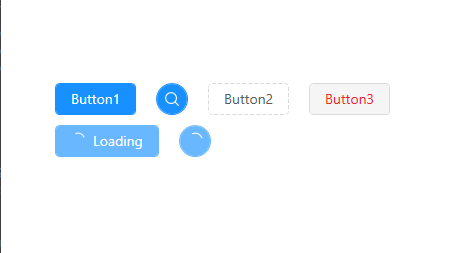
```
    xmlns:Ant="clr-namespace:AntWpf.Controls;assembly=AntWpf"

    <WrapPanel Orientation="Horizontal" VerticalAlignment="Center" HorizontalAlignment="Center">
        <Ant:Button Type="Primary" Margin="10,0" Content="Button1"/>
        <Ant:Button Type="Primary" Shape="Circle" Icon="SearchOutlined" Margin="10,0" />
        <Ant:Button Type="Dashed" Margin="10,0" Content="Button2"/>
        <Ant:Button Type="Danger" Margin="10,0" Content="Button3"/>
        <Ant:Button Type="Primary" Margin="10,10" Loading="True" Content="Loading"/>
        <Ant:Button Type="Primary" Shape="Circle"  Margin="10,10" Loading="True" />
    </WrapPanel>
```
`Icon` takes an `AntIconKey` (see [Icons](#icons)). In XAML the old names such as `search` or `check-circle.fill` are still accepted; in C# use the enum: `button.Icon = AntIconKey.SearchOutlined;`.
## Inputs

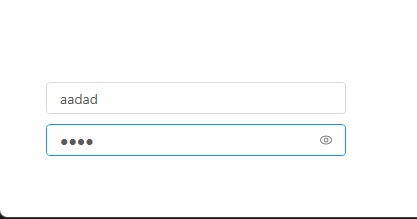
```
    xmlns:Ant="clr-namespace:AntWpf.Controls;assembly=AntWpf"

    <StackPanel Grid.Row="1" VerticalAlignment="Center" MinWidth="300"  HorizontalAlignment="Center">
      <TextBox Ant:Input.Placeholder="Place holder" Margin="0,10"/>
      <PasswordBox Ant:Input.Placeholder="PassworBox" Ant:Input.Eyeable="True"/>
      <ComboBox Margin="0,10" >
       <ComboBoxItem Content="Itemm 1"/>
       <ComboBoxItem Content="Itemm 3"/>
       <ComboBoxItem Content="Itemm 4"/>
     </ComboBox>
    </StackPanel>
```
# CheckBoxes & RadioButtons

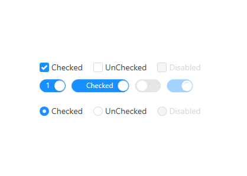
```
  <StackPanel Grid.Column="1" Orientation="Horizontal" VerticalAlignment="Center" MinWidth="300"  HorizontalAlignment="Center">
    <CheckBox Margin="5,0" Content="Checked" IsChecked="True"/>
    <CheckBox Margin="5,0" Content="UnChecked"/>
    <CheckBox Margin="5,0" Content="Disabled" IsEnabled="False"/>
</StackPanel>
<StackPanel Grid.Column="1" Orientation="Horizontal" VerticalAlignment="Center" MinWidth="300" Margin="0,12" HorizontalAlignment="Center">
    <Ant:Switch Margin="5,0" UnCheckedContent="0" Content="1" IsChecked="True"/>
    <Ant:Switch Margin="5,0" UnCheckedContent="UnChecked" IsChecked="True" Content="Checked"/>
    <Ant:Switch Margin="5,0" IsEnabled="False"/>
    <Ant:Switch Margin="5,0"  IsChecked="True"  Loading="True"/>
</StackPanel>
<StackPanel Grid.Column="1" Orientation="Horizontal" VerticalAlignment="Center" MinWidth="300" Margin="0,12" HorizontalAlignment="Center">
    <RadioButton Margin="5,0" GroupName="0" Content="Checked" IsChecked="True"/>
    <RadioButton Margin="5,0" GroupName="0" Content="UnChecked" />
    <RadioButton Margin="5,0" GroupName="0" Content="Disabled" IsEnabled="False" />
</StackPanel>
```
# ProgressBars

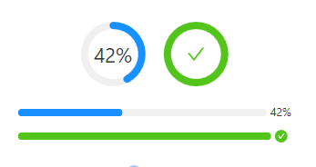
```
 <StackPanel Orientation="Horizontal" HorizontalAlignment="Center">
    <ProgressBar Ant:ProgressAssist.SmoothValue="{Binding ElementName=sld, Path=Value}" Margin="12,0" Maximum="100" BorderThickness="8" Minimum="0"  Width="67" Style="{StaticResource Ant.CircularProgressBar}"/>
    <ProgressBar  Value="100"  Margin="12,0" Maximum="100" BorderThickness="8" Minimum="0"  Width="67" Style="{StaticResource Ant.CircularProgressBar}"/>
 </StackPanel>
 <ProgressBar Ant:ProgressAssist.SmoothValue="{Binding ElementName=sld, Path=Value}"   Margin="0,24,0,12"  Maximum="100" IsIndeterminate="False"  Minimum="0"  Width="300" />
 <ProgressBar Value="100"  Maximum="100" IsIndeterminate="False"  Minimum="0"  Width="300" />
```
# Icons

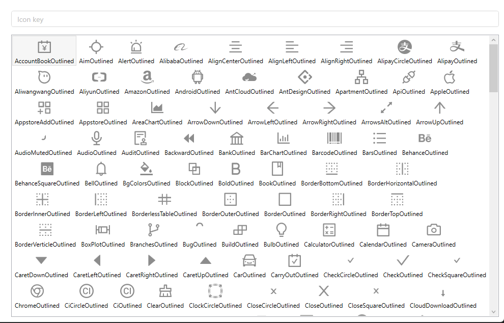
```
  <!-- Sized by FontSize (1em), color inherited from Foreground -->
  <Ant:AntIcon Key="AntCloudOutlined" />
  <Ant:AntIcon Key="AntCloudOutlined" FontSize="32" Foreground="{DynamicResource PrimaryBrush}" />
  <Ant:AntIcon Key="AntCloudOutlined" Width="32" Height="32" />

  <!-- LoadingOutlined spins automatically; Spin turns it on or off for any icon -->
  <Ant:AntIcon Key="LoadingOutlined" />
  <Ant:AntIcon Key="SyncOutlined" Spin="True" />
```
All keys are listed in the `AntIconKey` enum (the sample app has a searchable Icons page). The old `Icon` element (`<Ant:Icon Type="search" />`) is obsolete; use `AntIcon` instead.
## Tag

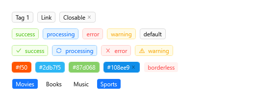
```
<Ant:Tag Content="Tag 1" />
<Ant:Tag Color="Success" Icon="CheckOutlined" Content="success" />
<Ant:Tag Color="#F50" Content="#f50" Closable="True" Closing="Tag_Closing" />
<Ant:Tag Bordered="False" Color="Error" Content="error" />
<Ant:CheckableTag Content="Movies" IsChecked="True" />
```
`Color` accepts `Success`, `Processing`, `Error`, `Warning`, `Default` or any brush. Set `e.Cancel = true` in `Closing` to keep the tag.

## Badge

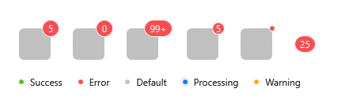
```
<Ant:Badge Count="5">
    <Border Width="40" Height="40" CornerRadius="6" Background="{DynamicResource AvatarBackground}" />
</Ant:Badge>
<Ant:Badge Count="100" OverflowCount="99">
    <Border Width="40" Height="40" CornerRadius="6" Background="{DynamicResource AvatarBackground}" />
</Ant:Badge>
<Ant:Badge Dot="True">
    <Ant:AntIcon Key="NotificationOutlined" Width="16" Height="16" />
</Ant:Badge>
<Ant:Badge Status="Processing" Text="Processing" />
```

## Alert

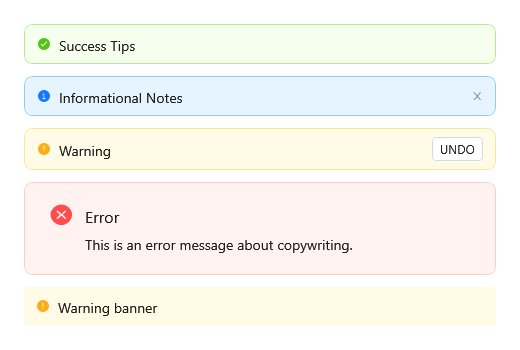
```
<Ant:Alert Type="Success" Message="Success Text" />
<Ant:Alert Type="Error" ShowIcon="True" Closable="True" Message="Error"
           Description="This is an error message about copywriting." />
<Ant:Alert Type="Info" ShowIcon="True" Message="With action">
    <Ant:Alert.Action>
        <Ant:Button Content="UNDO" Size="Small" />
    </Ant:Alert.Action>
</Ant:Alert>
<Ant:Alert Banner="True" Message="Warning text" />
```

## Tabs

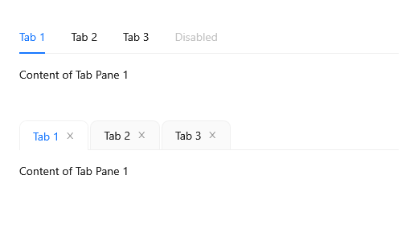
The standard `TabControl` and `TabItem` get the Ant Design style from `Controls.xaml`; options are attached properties of `Ant:Tabs`.
```
<TabControl Ant:Tabs.Centered="True" TabStripPlacement="Top">
    <TabItem Header="Tab 1"><TextBlock Text="Content of Tab 1" /></TabItem>
    <TabItem Header="Tab 2"><TextBlock Text="Content of Tab 2" /></TabItem>
</TabControl>

<TabControl Ant:Tabs.Type="Card" Ant:Tabs.Closable="True" Ant:Tabs.CloseRequested="Tabs_CloseRequested">
    <TabItem Header="Tab 1"><TextBlock Text="Content of Tab 1" /></TabItem>
    <TabItem Header="Tab 2"><TextBlock Text="Content of Tab 2" /></TabItem>
</TabControl>
```
```
private void Tabs_CloseRequested(object sender, RoutedEventArgs e)
    => ((TabControl)sender).Items.Remove(e.OriginalSource);
```

## Message

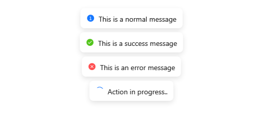
Messages are shown at the top of the active window and can be called from any thread.
```
using AntWpf.Controls;

Message.Success("This is a success message");

using (Message.Loading("Saving...", TimeSpan.Zero))
{
    await SaveAsync();
}

Message.Config(top: 24, duration: TimeSpan.FromSeconds(2), maxCount: 3);
```

## Modal

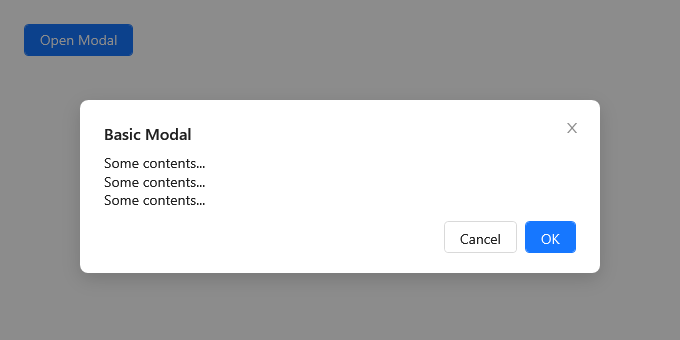
```
<Ant:Modal x:Name="modal" Title="Basic Modal" IsOpen="{Binding IsDialogOpen}" Ok="Modal_Ok">
    <TextBlock Text="Some contents..." />
</Ant:Modal>
```
```
// Keep the modal open while saving: cancel the Ok event and close it later.
private async void Modal_Ok(object sender, CancelEventArgs e)
{
    e.Cancel = true;
    modal.OkButtonLoading = true;
    await SaveAsync();
    modal.IsOpen = false;
}

bool ok = await Modal.Confirm("Do you want to delete these items?", "This cannot be undone.");
```

[](https://www.nuget.org/packages/AntWpf/)
[](https://github.com/Mumtozbekov/AntWpf/blob/master/AntWpf/LICENSE.txt)


</div>

